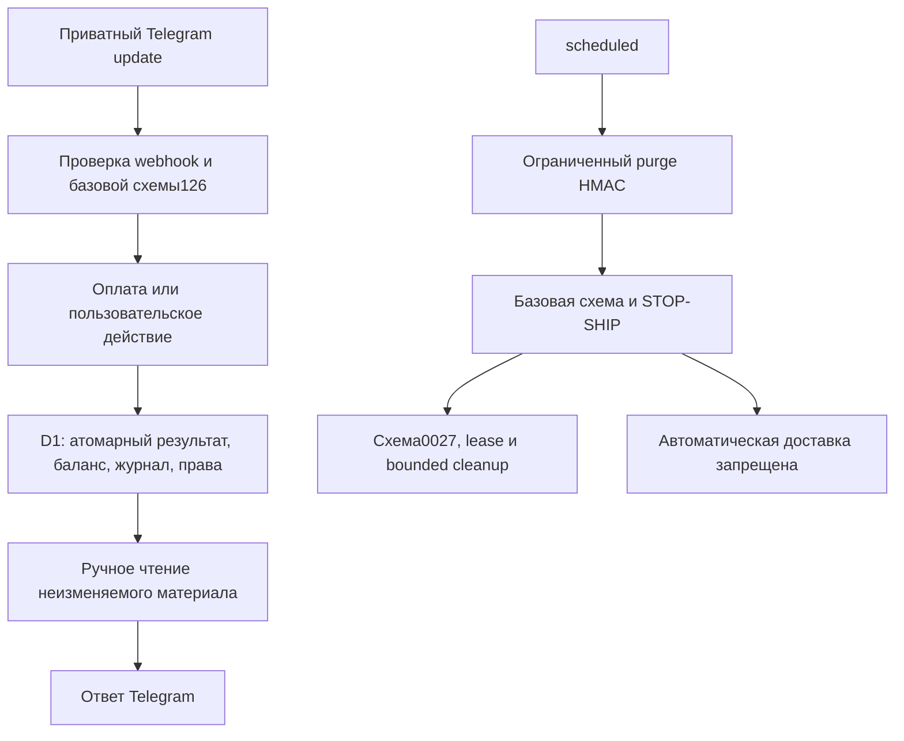

# Astra 2.4 RC — интеграционная архитектура

Основа —4eff5df, принятые TASK01–04 и STOP-SHIP владельца6798c67. Публичные новые функции не добавлены. Основной результат — одна сборка для будущего ограниченного staging и доказуемый отказ автоматической доставки до согласования opt-in.

## Сборка

`build-2.4.mjs` последовательно использует поддерживаемые2.3B/2.4A исходники и надстройки: TASK01(политика/HMAC/новые покупки) → TASK02/02B(представление прежнего selection) → TASK03(очередь) → TASK04(UI) → TASK05(release gate). `release/ASTRA_2_4_WORKER.js` не правится вручную. Исторические build flags существуют только в Node-сборщике для регрессии, не являются переменными Cloudflare и не снимают gate уже собранного RC.

Новая надстройка — `src/release05/gates.js` + `scripts/patch-task05.mjs`. До неё отдельным коммитом2c0c341 исправлена грамматика HMAC notice. Исходный движок/каталоги, денежные сервисы и SQL0021–27 не меняются. Proof-файл фиксирует только точечные отличия и позволяет побайтно восстановить Worker до release gate. Финальный manifest отдельно фиксирует SHA/размер Worker, maintenance и всех23Console-файлов.

## Обработка

Payment updates проходят прежний путь без наград за посещение. Новая покупка Таро5 и extended4 фиксируются прежними SQL guards/triggers с результатом; повтор читает сохранённое. Награды и HMAC fence также связываются одним statement. Платёжные proofs/refunds обрабатываются при закрытом магазине, а не теряются вместе с витриной. Законные возвраты не превращены в пользовательский обмен пыли.

Private callback/сообщение остаётся источником активности по прежним правилам. Уведомления включаются/отключаются как предпочтение с прежней идемпотентной целью update; это не длительное доказательство согласия. Тексты не обещают доставку при активном STOP-SHIP.

## Release gate

Пока нет одобренной0028, три функции автоматического пути закрыты: вход broadcast, runBroadcast03 и broadcastSend03. Нет env-bypass или нового административного enable endpoint. Дормантная прежняя очередь сохранена для аудита, но не достижима обычным scheduled-путём и не может использовать закрытый транспорт.

Очистка сохранена отдельно от доставки: проверка11объектов0027 → условный lease → четыре прежних bounded statements → token-guarded release. Никакой выборки пользователей/знаков, генерации или отправки. HMAC purge остаётся во внешней обёртке. Полный обычный утренний invocation — локально6D1calls/9statements/0HTTP; lease/сбой приводят к безопасному отказу. Такой режим не доказывает будущую производительность отправки после0028.

Health503/ready=false — намеренное состояние. manual_content_ready отдельно отражает техническую готовность ручного контента; public_ready/broadcast_delivery_allowed=false. Прежний blocker схемы/ключей сохраняется. Owner approval, законность и реальная платформа не выводятся автоматически из технических флагов.

## Схема и сохранность

Базовая схема126 и дополнительная очередь11объектов, порядок0024→25→26→27. Нет исполняемой0028, ALTER старых тарифов или переписывания snapshots. Установка требует writer pause, проверки неактивной исходной0025 и реального backup/restore rehearsal. После новых triggers старый Worker не штатный rollback.

`/delete` стирает обычный профиль/очередь/материалы и FK-зависимости; минимальные HMAC-права и необходимые платёжные доказательства имеют раскрытые отдельные правила. Персональная псевдонимизация не объявляется анонимностью или законностью сама по себе. Предложение consent28 хранится отдельно и не использует бонусный HMAC как shadow-реестр подписчиков.

## Проверка и границы

Исторические сборки проверяются со своими контрактами; финальный модуль отдельно инструментируется test-only preload для подсчёта именно export.fetch/scheduled. SQL workers/private VM probes не выданы за API-тесты. На финальном модуле выполнены12×90реальных чтений, финансовые/UI/replay/STOP-SHIP проверки; миграции прошли локальную установку/restore с FK ON/OFF. Исторические8/20/100/403/429/unknown очереди не объявлены тестом ещё не реализованного gate28.

Реальные D1/Cloudflare CPU/rows/квоты, нативный Telegram, consent28 и юридические решения остаются внешними gates. Конкретные шаги — STAGING_GUIDE, MANUAL_CHECKLIST, DECISIONS и CONSENT_PROPOSAL этого этапа. Ни один из них не даёт автоматического разрешения на remote действия.
